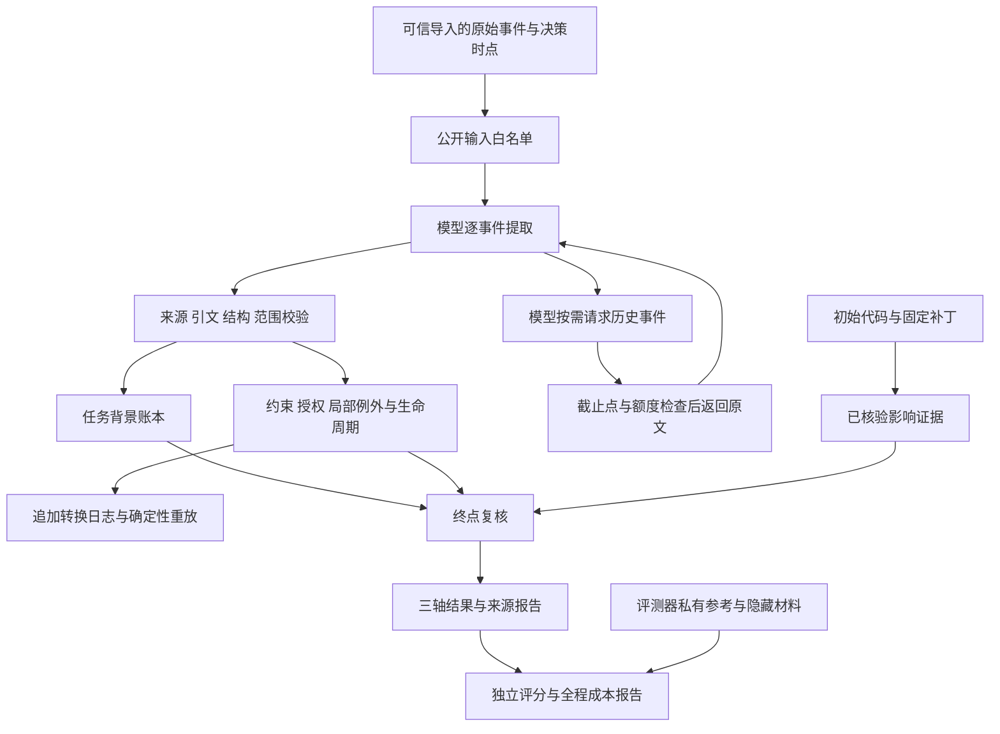

# WritScope（约界）项目接手报告

日期：2026-10-27。适用对象：接手本地项目、继续研究和实现的开发者。当前工作目录：`D:\AI-Project\writscope`。本报告依据仓库规格、保存运行及当日最终审查编写；迁移目录后，请将文中的绝对路径替换为新的项目根目录。

公开候选版整理注：本报告正文保留交接时点；2026-10-27 仅将文档链接改为仓库相对路径。`reports/local/` 链接在恢复[精选证据包](../reports/public-v0.1/README.md)后于本地查看；GitHub 页面不直接展开归档内文件。当前整理和验证状态见[首次公开版](first-public-release.md)。

## 1. 先用五分钟了解项目

WritScope 研究的是：**编码任务经过多轮要求变化后，当前候选补丁造成的具体兼容性影响，是否被用户当前有效的授权覆盖。**

典型情景：用户要求修复页面，同时保留旧 API 的 `status` 字段；工具随后报告页面需要 `state`。编码 Agent 提交一个把服务端 `status` 改成 `state` 的补丁。页面可能修好了，但旧接口契约被破坏。若用户后来明确批准这项破坏，补丁可以被允许；若只批准未来 v2，或只允许客户端本地映射，则不能据此放行 v1 服务端的字段替换。

系统分别回答三个问题：

| 输出轴 | 回答什么 | 示例 |
| --- | --- | --- |
| `impact` | 补丁实际造成什么影响 | 删除旧字段，属于 `breaking` |
| `authorization` | 当前有效用户许可是否覆盖这些影响 | v2 许可不覆盖 v1，属于 `not_covered` |
| `decision` | 应如何处理本次候选 | `revise`；也可能是 `allow / ask / investigate` |

当前项目已经实现样例、模型接口、两种完整上下文基线、增量状态维护、按需历史回查、终点复核、失败停止、预算记录和保存后重放。**S3 开发验收已完成，口径为作者审核；独立研究审核仍待外部审核者。S4 的 30 实例正式开发评测尚未运行。**

接手后的主要工作是准备 S4 数据与统一比较配置，而不是继续为 S3 的同一个调试案例反复购买诊断。当前没有证据证明增量方法优于完整上下文清单强基线。

当前状态以[最终审查](../docs/s3-development-final-audit-20261027.md)和[项目状态](../docs/project-status.md)为准。[初始交接书](../docs/project-brief.md)保留项目最初需求，其中“尚无代码”等描述是历史快照。

## 2. 大方向与研究假设

第一版聚焦 Python/FastAPI 合成应用，对固定候选补丁做离线复核，覆盖 HTTP 输出字段存在性、字段值语义及相关用户授权。FastAPI 是被测样例；目前交付形态是 Python 组件、CLI 和 JSON/Markdown 报告。

核心可证伪假设是：逐事件维护带来源、范围、条件和生命周期的约束/授权状态，可能更稳定地处理后到要求、局部例外、撤销和重授，或者减少重复处理历史的成本。它必须接受完整上下文强基线的检验：如果强基线质量相当或更好，而增量维护没有成本优势，应收缩方法收益主张，保留评测框架、失败分析和负结果。

研究推进顺序为：

1. **授权能力实验 A：** 给三方法同一份已核验的代码影响证据，控制代码理解差异，比较授权范围判断。
2. **组合实验 B：** 在权限边界就绪后，让方法使用同等代码和验证工具，分别评估影响判断、授权判断与最终决定。
3. **真实编码过程：** 只有前两步显示值得继续，才考虑接入真实编码 Agent，另报任务完成率、迭代与总成本。

目前没有 IDE/PR 集成、多语言产品、任意代码执行沙箱或真实编码 Agent 闭环。后续扩展须由实验结果驱动。

## 3. 创新方向：可以主张什么，仍须证明什么

应将下列内容称为**候选贡献或研究设计**，不能写成已证明的新颖性或性能优势。

| 候选贡献 | 本项目具体做法 | 还需要的研究证据 |
| --- | --- | --- |
| 经验证代码影响与有效用户授权逐项结合 | 对补丁的每项影响，检查对象、版本、操作、条件及有效时间；已授权破坏仍保持 `impact=breaking` | 在更多受控案例中证明区分能力，并排除单纯代码理解差异 |
| 有来源、局部例外及生命周期的持续状态 | 保存精确用户引文、原始事件、撤销/替代/重授关系；较窄许可不删除较宽约束 | 相对完整历史清单的准确性或总成本收益；长历史和未见家族证据 |
| 可归因、可重放且全成本核算的实验框架 | 区分提取、状态更新、范围匹配、最终复核及运行失败；保留原始响应、哈希、用量和失败分母 | 足量受控比较；独立参考审核；等配置与预算匹配分别成立 |

已实现的工程价值是：可以解释“哪条用户消息在什么范围产生了什么状态，模型在何处提错，程序为什么拒绝，以及这次失败花了多少调用”。这类可审查性已具备有限开发证据。

“同一操作只改变授权证据”“结构化记忆”“工具内容不能成为用户授权”都不能单独被称为本项目首创。[研究定位文档](../docs/research-direction-2026-10-20.md)已有截至 2026-10-20 的相关工作线索；该文档不是穷尽检索，也不是当前版本的新颖性证明。接手者在论文或公开材料中使用“首次”“优于”等表述前，应重新核对原论文、项目版本及许可证。

## 4. 我们已经完成了什么

| 阶段 | 已交付内容 | 证据边界 |
| --- | --- | --- |
| M1：首例与影响验证 | 固定 FastAPI API、破坏补丁、客户端兼容修复、三种只改变用户授权的历史；隔离副本执行和公开影响证据 | 可信合成代码的有限契约验证；不是通用兼容性检查器 |
| M2：完整上下文基线 | `full_direct` 与 `full_checklist`；共同输入、严格输出、单独评分和费用日志；真实 DeepSeek 接通 | 旧跨度契约六项无效；新引文契约真实运行 5/6 有效。两次都保留，不能用后者追改前者 |
| S3：增量组件 | 逐事件提取、任务背景账本、原子状态批次、精确范围引用、追加日志、撤销/重授、回放、历史回查、终点复核 | 已满足作者审核的开发出口；模型语义仍可能出错，结构校验不保证语义正确 |
| S3.4：隔离诊断 | 三历史有限逐前缀审核/状态对齐、语义表示边界、六个生命周期分支和成本对账 | 人工材料只在评测器侧；不是独立金标准，未做人工状态条件下的真实模型消融 |
| 三方法共同开发轮 | 三历史 × 三方法九项均实际尝试，统一报告保留失败及原分母 | 六基线完成、三增量失败；该轮没有增量有效终点，不能作方法优劣排名 |
| v8 最新真实诊断 | c004 单轨完成真实自主回查、原文返回、接受续答及有效终点；保存后回放成功 | 一个已调试家族、R=1 的开发观察；不能与旧共同轮拼接成同轮比较 |
| S4：首轮评测 | 有数据设计、协议与冻结要求 | 30 实例数据集、正式统一配置及真实比较尚未交付 |

最有代表性的当前记录：

| 记录 | 事实 | 文件 |
| --- | --- | --- |
| 最终开发审查 | 2026-10-27 重新复验 v8、九项覆盖、四个 S3.4 入口；10 项定向测试通过；新增模型调用 0 | [审查报告](../docs/s3-development-final-audit-20261027.md) |
| v8 真实诊断 | 7 请求：5 提取、1 回查续答、1 终点；结果 `breaking / not_covered / revise`，与作者草稿一致 | [真实记录](../docs/s3-development-v8-real-review.md) |
| v8 费用 | 本地预留 1.125708 元，原冻结峰时估算 0.177945 元；提供商实付和推理 token 未知 | [机器报告](../reports/local/s3-development-v8-live-report-20261026/report.md) |
| 共同覆盖轮 | 九项均尝试，六完成、三失败；全部尝试和未知成本保留 | [共同轮记录](../docs/s3-coverage-followup-real-review.md) |

`c004` 为专门补充的同家族回查开发诊断，不能当成新的独立任务家族或 S4 未见样本。

## 5. 当前系统如何工作



模型提出语义候选，程序核验可确定的事实。可信角色由导入器/运行器提供，模型不能自报“我是用户”改变权限。客户端本地映射、不增加请求等属于任务背景，不能自动提升为服务端字段变更许可。

局部授权只对匹配约束建立例外。`constraint_refs` 必须指向活跃且与授权至少有一个完全相同 `Subject` 的约束；保留其他约束 active，并不要求把它们全部列入当前 grant。

最新回查诊断的初始逐事件请求只显示当前事件和历史索引；旧正文在模型请求后返回。最终复核仍可见原始事件。**同一公开证据来源，不等于各阶段文本可见性完全相同。** S4 必须重新冻结并披露这种输入策略，不能将 v8 诊断直接当成三方法公平比较。

## 6. 代码从哪里读起

| 层 | 主要入口 | 接手者要理解的内容 |
| --- | --- | --- |
| 基础契约与信任 | [events.py](../src/writscope/events.py)、[contracts.py](../src/writscope/contracts.py)、[artifacts.py](../src/writscope/artifacts.py) | 可信角色、精确引文、三轴组合、文件白名单与哈希 |
| 影响与两基线 | [m1.py](../src/writscope/m1.py)、[baselines](../src/writscope/baselines/__init__.py)、[m2b.py](../src/writscope/m2b.py) | 固定样例执行、共同公开证据、完整上下文请求与评分分离 |
| 状态机制 | [state.py](../src/writscope/state.py)、[m3f_scope_policy.py](../scripts/m3f_scope_policy.py)、[m3j_transition_batch.py](../scripts/m3j_transition_batch.py) | 旧核心与后续严格范围适配、批次原子提交和拒绝 |
| 背景与回查 | [m3i_task_context.py](../scripts/m3i_task_context.py)、[m3k_history_lookup.py](../scripts/m3k_history_lookup.py) | 单独背景账本、历史可见性、限额及原文返回 |
| 最新完整开发轨迹 | [s3_scripted_trajectory_v4.py](../scripts/s3_scripted_trajectory_v4.py)、[s3_interaction_v4.py](../scripts/s3_interaction_v4.py) | 请求/续答/终点生成与严格解析；脚本重建不代表真实模型调用 |
| 最新真实单例入口 | [s3_acceptance_v8.py](../scripts/s3_acceptance_v8.py)、[report_v8](../scripts/s3_acceptance_report_v8.py) | 精确计划授权、预算预留、一次性启动、真实响应保存、重放与评分 |
| 最新使用提示 | [interaction v8](../prompts/incremental_interaction_v8.md)、[final review v2](../prompts/incremental_final_review_v2.md) | 局部映射/授权区分、范围引用、条件与权限/事实来源字段 |
| S3.4 诊断 | [离线验收矩阵](../docs/s3-4-offline-acceptance-matrix.md)所列四个入口 | 私有参考隔离、原版回放后诊断和成本重算 |

**v8 runner 是 c004 单例诊断入口，不是现成的 S4 通用运行器。** 历史脚本和提示词为重放而保留；某些旧脚本接受过后来修正的表示，不应因为它们存在就选作新实验默认。重构应另立新版本，保证旧运行仍能从冻结证据重建。

## 7. 已经踩过的坑

| 问题 | 已知处理方式与接续要求 |
| --- | --- |
| 模型生成字符偏移经常错误 | 采用 `source_quote_v1`：模型给事件 ID 与唯一精确原文，由程序派生位置；旧跨度失败保持原分数 |
| 把客户端 `state` 映射当成服务端改字段许可 | 分开任务背景与授权；grant 必须有明确服务器/API 可见操作的用户引文 |
| grant、supersede、revoke 的目标类型混用 | 按操作分型 schema；不自动删 targets、猜目标或修复非法响应 |
| 跨版本/跨字段约束被引用到当前 grant | 精确 Subject 范围校验；不通过扩大作用域来让响应过关 |
| 条件类型、历史事件 ID 和工件 ID 混淆 | 条件限于已支持类型；`e002` 是历史查找 ID，`patch` 是工件 ID；报告摘要与候选不一致保留未满足 |
| 最终复核把工具事实放到授权来源字段 | 逐影响授权来源只引用用户；工具事实引用放顶层来源字段，见终点提示 v2 |
| verifier 读取 `failure=null` 或摘要原因丢失 | 旧记录用只读兼容层或旁路诊断，不覆盖原失败；新公共运行器须覆盖完成/失败/null 等组合 |
| Windows 受限环境的异步初始化挂起 | 已定位过 `socketpair`；先用最小异步检查区分环境限制，再在允许环境中执行只读复验，不以挂起证明业务失败 |

这些故障是研究与工程交付的一部分。不要为了得到漂亮的通过率修改历史输出、丢弃失败、复用旧许可或自动补跑。

## 8. 接手时必须一起拿到哪些材料

当前本地 Git 分支为 `main`，HEAD 为 `26cbaf4fbe7e87a58854104053e048e17452dadc`（M3b 离线接线提交），未配置远程仓库。本报告编写前，`git status` 有 9 条已跟踪修改和 137 条未跟踪条目；目录会折叠计数，不代表文件数。后续 S3 工作大量位于未提交文件中。

**只 clone 当前 HEAD 会缺少后续 S3 实现；只复制代码也无法重放当前验收。** `.gitignore` 忽略了 `reports/local/`，其中保存了真实请求/响应、预检、授权收据、一次性 claim、模拟控制和诊断。该目录下存在重复演练与测试临时记录，数量不代表真实样本数。

交接时至少保留：

1. 当前工作树中的源码、脚本、提示词、规格、测试、文档、`pyproject.toml` 和 `uv.lock`，包含尚未跟踪的文件。
2. `fixtures/` 与精选 `reports/`，尤其 `reports/m1-2026-10-18/inputs/` 的公开输入依赖。
3. `evaluation_private/`，仅提供给接手者的评测器角色，不能进入模型工作区或输入白名单。
4. `reports/local/` 的保存证据及其依赖。先做完整受控备份，再按验证器依赖整理；不要只挑最新 v8 目录。
5. [最终审查证据清单](../reports/local/s3-development-final-audit-20261027/evidence.json)、v8 预检/真实/报告目录、旧九项覆盖运行及其预检/兼容回放依赖、S3.4 诊断及 M3c/M3d/M3s 来源运行。

迁移时另行检查配置和日志的敏感内容；不打包 `.env`、API 密钥、全局配置、`.venv` 或缓存。模型凭据由接手者按新授权在本地配置。原始保存证据应保持字节和哈希；需要脱敏时另出明确派生副本，不能冒充原件。

本次交付是接手说明报告，尚未创建迁移压缩包或新的 Git 归档提交。接手前应完成受控快照，并在目标机器从保存证据复验一次。若两人同时开发，应使用独立分支/工作目录，避免共同修改同一脏工作树。

## 9. 接手者第一轮操作

先阅读以下材料，不需要从几十份历史阶段报告逐份开始：

1. [AGENTS.md](../AGENTS.md)：授权、隔离和证据规则。
2. 本报告与[最终开发验收](../docs/s3-development-final-audit-20261027.md)：当前能做什么、还有哪些研究限制。
3. [初始需求](../docs/project-brief.md)和[研究定位](../docs/research-direction-2026-10-20.md)：大方向和可证伪假设。
4. [实现计划](../docs/implementation-plan.md)、[数据契约](../specs/data-contracts.md)、[评测协议](../docs/evaluation-protocol.md)、[决策记录](../docs/decisions.md)。
5. [首例设计](../specs/first-case.md)、v8 真实记录和共同覆盖轮记录；这些文档含作者答案，不可直接传给被测模型。

Python 要求为 3.12，原项目环境实际验证版本为 3.12.4。依赖锁文件是当前依据；现有技术栈为 FastAPI、Pydantic、httpx、pytest，不需要启动 Web 服务来复验样例。

迁移到新机器时，在确认代码和本地报告已经齐备后同步项目环境：

```powershell
Set-Location 'D:\AI-Project\writscope'
uv --cache-dir .work/uv-cache sync --locked --python 3.12
```

优先执行以下离线检查；它们不会发起真实模型请求：

```powershell
.\.venv\Scripts\python.exe -m scripts.s3_acceptance_v8 verify --preflight reports/local/s3-development-v8-preflight-final-20261026 --output reports/local/s3-development-v8-live-20261026
.\.venv\Scripts\python.exe -m pytest tests/test_s3_acceptance_v8.py -q -p no:cacheprovider
```

共同九项覆盖和四份 S3.4 验证的精确入口见[最终审查](../docs/s3-development-final-audit-20261027.md)及其机器证据；S3.4 参数见[离线矩阵](../docs/s3-4-offline-acceptance-matrix.md)。若缺文件、哈希变化或环境不一致，先定位迁移问题。不要用新的付费运行替代旧记录复验。

## 10. 接下来具体应该做什么

默认推进 S4 的离线准备。独立审核作为外部待办保留，不阻塞数据与工程准备；正式比较仍须完成运行冻结和新授权。

| 顺序 | 要做的工作 | 具体交付 | 完成判据 |
| --- | --- | --- | --- |
| 0 | 固定接手快照并复验 | 代码与本地证据清单、可恢复快照、目标环境复验记录 | 当前 v8 与共同覆盖可重建；关键本地工件没有因 Git 忽略而遗漏 |
| 1 | 编制 S4 数据目录和受控变量矩阵 | 30 实例草案、家族/配对/用途清单、公开与私有材料清单 | 数量正确、控制变量明确、中性 ID 不泄露答案，先不调用模型 |
| 2 | 完成两个样例应用和逐例影响证据 | 字段存在性、字段值语义；候选/兼容解/契约/实际影响验证 | 每对只有决定授权的文本不同，代码影响可执行且来源可追溯 |
| 3 | 建立新版本公共运行器与提示冻结候选 | 同一实验块内三方法运行、输入策略、预算账本、失败规则及统一报告 | 各轨从空状态起步；完整上下文清单基线保持；失败、null、缺失和超限可审计 |
| 4 | 完成正式实验冻结 | 实例/提示/模型与实际版本、R、方法顺序、阈值、费率/预算、停止与重试规则、环境和代码哈希 | 运行前填齐评测协议冻结表，目标与阈值不随结果挑选 |
| 5 | 获得新授权后分轨真实执行 | A 授权实验与 B 组合实验各自计划、原始记录及评分 | 预算与具体外发材料获批准；B 的工具权限边界先就绪 |
| 6 | 研究复盘 | 三轴及成对指标、误放行/误拦截、无效输出、全程成本与错误分类 | 保留所有计划分母；明确支持什么、不能支持什么；决定继续或收缩 |

30 实例的既定组成：两个应用 × 六组成对变量 × 每对两侧 = 24，再加 4 个影响对照和 2 个实质歧义实例。六个配对变量为明确授权、API 版本、操作、对象、撤销/重授、局部任务压力。首例内容纳入对应配对，不额外累加成 33；c004 也不能直接当作独立未见样本加入。

首轮全部是 dev/pilot。底层任务家族和同对变体不跨集合；未来泛化验证另建未参与调试的家族。A/B 分开报告，不把额外调用或额外人工信息的收益直接解释为状态维护收益。

等配置比较和预算匹配比较需分别设计。incremental 的所有提取、状态维护、回查续答、终点及失败尝试都归入其总成本；本地计算耗时和无法取得的账目分别记录。完整上下文方法有足够空间读取全部必要历史，不能靠削弱强基线制造优势。

## 11. 授权、外部依赖与对外表述

历史付费批准均绑定具体一次性计划，已经执行的授权不可复用。v8 计划文件 SHA-256 为 `806ce80878cb94f314c76863c22aa567b656ac30412e9547d5a7acba7c6228c7`，该计划的 3 元授权已使用。接手本项目不等于获准新一轮付费请求、材料外发、方法比较或发布远程仓库。

每次新真实运行先形成可审查的计划：案例与提示词、模型、源文件/计划哈希、调用上限、单并发或明确并发、超时、重试、失败停止、价格、本地金额及具体外发材料。只有精确范围获授权后才访问凭据。一次性 claim 和原授权收据继续保留。

目前外部待办为实际独立审核者。空白审核包已经准备，作者自审、另一个脚本或另一代理不能直接冒充独立审核。若找不到，准确状态保持“开发验收通过，独立研究验收待审核”；可以推进准备工作，不能对外改称完整独立验证完成。

可以向外介绍：**已实现一个有来源和范围约束的兼容性授权复核原型，具备真实模型增量提取、自主历史回查、终点复核及可重放成本记录，完成有限合成案例的开发验收。**

目前不能声称：首创授权状态维护、增量方法准确率或成本优于强基线、30 实例评测完成、未见家族泛化、降低真实编码 Agent 越界率、具备任意不可信代码沙箱或完整产品交付。

## 12. 给接手者的第一项任务

在确认材料迁移与离线复验成功后，先提交一份 **S4 数据与实验冻结草案**：列出 30 实例设计、两应用实现范围、参考与公开材料隔离方案、三方法公共入口需要补的工程项、等配置/预算匹配安排，以及仍待决的模型/R/阈值和预算。此时先产出可审查方案与离线证据，再申请真实执行。

项目继续与否的判断应取决于这个受控比较能否支持研究假设，而不取决于为同一个开发场景积累了多少次成功试跑。
