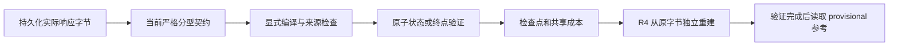

# S4 离线契约收敛与联合验收

2026-11-04。本轮执行用户批准的第 1、2 项离线工作。新增契约 `s4_compact_API_compiler_v2`，新工程候选 SHA `0ef9be84a94f272109535b483813b5eb91f4ddb7fc158f70a8d9c89e340c17d7`，绑定 **263** 份源码、规格、提示词和定向测试文件。它是离线工程候选，不是下一次付费试跑候选或新的执行批准。真实发送关闭。

## 第 1 项：当前契约与维护入口

| v5 卡点 | 本轮实现 | 仍由模型负责 |
| --- | --- | --- |
| 每项重复自由文本约束、typed API 表和来源 | final 的约束只声明一次：ID、主体、typed predicate、生命周期、解释状态及单份完整用户 source | 选对完整 API 义务引文、主体、类型和生命周期 |
| 值语义在外层、scope_source、meaning_source、source_refs 反复写同一信息 | 增量以 source_quote、final 以 source 提供完整范围；qualifiers 只写内部 meaning_quote；程序绑定事件并生成重复引用 | 原文含义片段与 source_text 选择，含义理解；英文 explanation 仅供说明 |
| 清单漏写 exact_keys 的 add_alias 覆盖 | 三方法共同按 predicate/精确键声明派生完整操作覆盖，模型不再枚举约束 change_types | 判断约束是什么、是否 exact_keys，以及实际授权与最终决策 |
| Union 的无关分支报错掩盖真实错误 | 增量按 operation 分型；supersede 再按约束/授权目标分型 | 提交正确操作及有效目标；no_change 必须独占批次 |
| 多版提示与配置不断层叠 | 新提示只复用共同研究规则，提供一份当前契约；新入口直接复用共享执行内核、账本和 R4 | 按当前 wire schema 输出；维护状态仍保留可审计的编译后原生表示 |

维护入口：[离线入口](../scripts/s4_contract_convergence_offline.py)，只提供 prepare/offline/verify；[契约与编译器](../scripts/s4_compiled_contract_v2.py)、[规格](../specs/s4-compiled-contract-v2.md)、[固定控制工具](../scripts/s4_contract_convergence_acceptance.py)。没有复制完整运行器、HTTP worker、账本或状态内核。旧入口保留给其绑定版本的历史回放。

程序只生成**已经在契约中公开声明的冗余字段**，不从相邻约束、整段历史、工具消息或别的版本推断缺失 API 范围。局部值含义片段仍不能独自充当范围锚点。旧格式的重复字段在新 wire schema 中报错，不会悄悄忽略或覆盖。授权的操作、条件、来源仍由模型声明并经过旧内核检查，不由覆盖映射补出。

字段存在覆盖 remove/replace；值语义覆盖 semantic change；响应形状覆盖 remove/replace/semantic change，exact_keys=true 再覆盖 add_alias。该规则与补丁实际只做哪一种操作无关。三方法同一映射，增量 assessment 也使用它。不可据此声称自然语言含义、翻译或授权意图已被程序证明。



usage 保存逻辑输入/编译结果哈希与解析来源证明；状态转换保留当前编译证明和原 no_change 事件绑定。它们不冒充原始响应字节哈希，原始字节继续由共享传输日志保存。R4 重算相同投影后对账。来源、隔离、哈希、账本和额度故障仍停全轮，普通契约/传输错误和终点摘要冲突停单轨。

## 第 2 项：同候选定向验收

**51 项测试通过，262.38 秒**，结果见 [tests-final.xml](../reports/s4-contract-convergence-v2/tests-final.xml)。覆盖三方法共同投影、覆盖枚举、含义引文及唯一性、工具/未来/错版本来源、禁止借用范围、额外字段、分型错误、no_change 五事件绑定、生命周期替代、四操作授权、精确值与条件、原子回滚、终点冲突、来源故障先于参考、关闭真实入口和原 v5 失败回放。

同一候选的九组固定控制共有 **27 个计划项、67 次模拟尝试**，没有模型准确率。这些尝试不包含真实 HTTP 模型调用：

| 控制 | 完成 / 失败 / 未运行 | 模拟尝试 | R4 | 参考读取 |
| --- | --- | ---: | --- | --- |
| normal：三方法各一次回查，增量五事件及终点 | 3 / 0 / 0 | 11 | settled | 是 |
| no-lookup：无回查的完整链 | 3 / 0 / 0 | 8 | settled | 是 |
| bad-anchor：增量局部含义片段冒充范围 | 2 / 1 / 0 | 6 | settled | 是 |
| old-no-change：多余旧引文字段 | 2 / 1 / 0 | 8 | settled | 是 |
| source-fault：工具来源不能支持用户约束 | 0 / 1 / 2 | 2 | prefix only | 否 |
| summary-conflict：终点规范性原文偏离维护状态 | 2 / 1 / 0 | 11 | settled | 是 |
| truncated：finish_reason=length | 2 / 1 / 0 | 10 | settled | 是 |
| timeout：固定传输超时 | 2 / 1 / 0 | 10 | settled | 是 |
| interrupted：响应已落盘、验证尚未开始 | 0 / 1 / 2 | 1 | prefix only | 否 |

五组复用通过测试时保存的原轨迹，另四组只补做尚缺的固定控制，没有再次执行相同的已通过测试路径。复制后对原字节逐一核对并独立回放。控制汇总、实际请求/固定响应、转换、账本和报告在 [controls-summary.json](../reports/s4-contract-convergence-v2/controls-summary.json) 及其 controls 目录。

normal 中增量三处 no_change 分别绑定 e002/e003/e005；事件 ID、seq、角色和内容哈希来自执行器，不来自模型引文。回查与续答实际经过共同路径，五事件、assessment、规范性终点一致性及 R4 重建通过。explanation 可改变而不改变规范性含义；source_text 改动仍使摘要拒绝。固定响应不证明真实模型会遵守新格式，也不签收这些事件的语义。

中断控制保留 status=received 的原响应，error/usage 仍未决，不填造已验证结果；预留 2.129920 元条件金额保留。超时的失败用量及实际账单未知，不当作零。所有失败仍占原计划分母；模拟条件预留不是费用或新预算授权。预算、次数、单并发、无重试、同等证据与工具权限和完整成本逻辑均复用原共享实现。

### 新目录恢复

恢复检查已通过，结果见 [recovery-result.json](../reports/s4-contract-convergence-v2/recovery-result.json)。新目录核对 **1,038 份清单工件**，显式确认模块从副本加载；九份当前报告和 v2 成功/v5 失败两份历史报告均精确重算一致，前后原字节不变。副本中又执行一次新的无密钥固定演示：三方法全完成、8 次模拟尝试、R4 settled。该演示与上述 67 次控制尝试分开登记。复用项目 Python 环境，没有重新安装依赖，没有将其写成新 CI 验证。

## 历史保留与验收边界

开工前 Git 状态已检查，既有五份 tracked 改动保留。**942 份既有文件哈希保持不变**，包括 v1–v5 源码/候选、原始记录、评分、用户批准与已使用 claim；见 [保留核验](../reports/s4-contract-convergence-v2/preservation-verification.json)。原 v5 三条契约失败按 v5 规则仍为失败，不用本轮投影追改。新候选未继承剩余请求槽、预算余量或任何再次启动权限。

开发期的首批 41 项检查、Windows 临时目录权限失败及中途停止的联动尝试另存，不拼成最终候选通过数。最终 51 项使用当前候选完整重跑；Windows 测试仅在进程内将临时目录 mkdir 的 0700 兼容为 0777，并关闭 pytest 缓存，产品/传输/批准逻辑不变。初次 ACL 失败不归为产品回归；没有修改全局环境。

本轮尚未覆盖：当前契约的 30×3×R=3 全批、所有旧故障矩阵的重跑、新模型完整增量链、新 Linux/Windows CI、全新依赖安装、正式语义/实验冻结和真实比较。预算/账本/生产批准源/真实 HTTP 底层沿用旧绑定，未把其历史测试写成本轮新测。参考仍 provisional、逐例未签收、独立审核 `not_performed_skipped_by_user`；等配置主块保留，预算匹配后置。

## 后续操作

本轮助手密钥读取、真实模型请求、材料外发、新实验费用、GitHub 更新均为 **0**。用户无需在本机启动任何试跑。

**第 1、2 项的当前单例离线工程范围已收尾**，机器状态见 [completion.json](../reports/s4-contract-convergence-v2/completion.json)。下一步是第 3 项公开发布整理：根 README/导航/状态、精选证据、凭据扫描和无密钥 CI，随后再按届时授权更新 GitHub。当前没有创建或批准下一次真实执行，也没有把本轮离线完成等同于 S4 正式比较结束。

离线完整控制可在新目录重建（目标目录必须不存在）：

```powershell
Set-Location -LiteralPath 'D:\AI-Project\writscope'
& .\.venv\Scripts\python.exe -m scripts.s4_contract_convergence_acceptance --output .work/compact-v2-reproduction --price reports/s4-owner-pilot-v5/public-price-review.json
```

这里的价格文件仅作为历史固定控制元数据，命令不读取密钥，也不授权真实传输。
