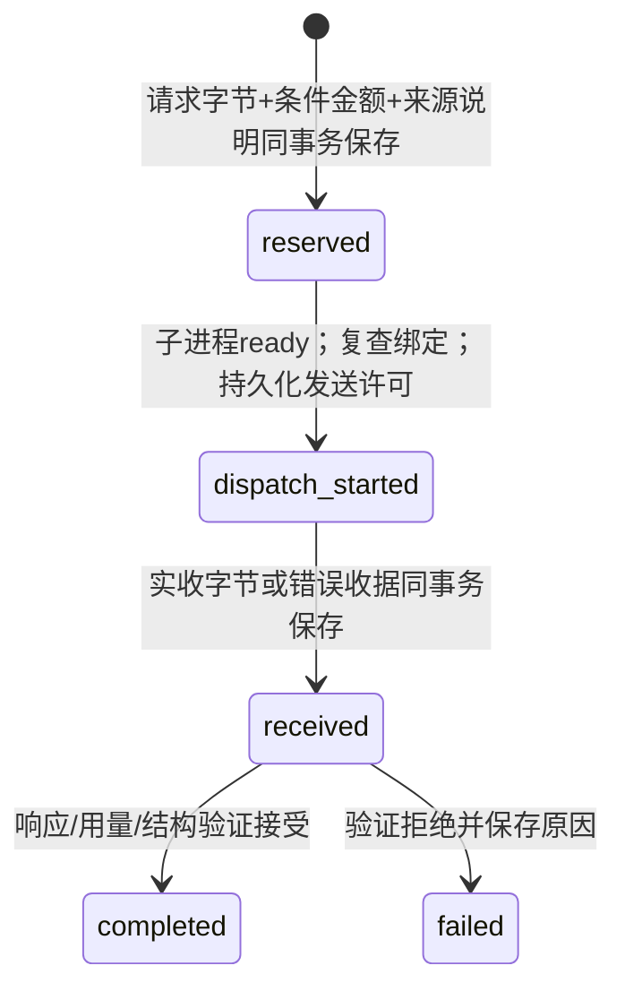

# S4 负责人本机启动诊断 v1

2026-11-03。另立人工监督开发诊断入口，不修改旧 R3–R7 冻结文件，也不把生产宿主签名或服务商计费上界写成已取得。当前执行批准为空，密钥读取、真实模型请求、材料外发及费用均未授权。

## 范围和复用

维护入口 `scripts/s4_owner_pilot.py`；传输组件 `s4_owner_pilot_transport.py`；独立回放适配 `s4_owner_pilot_replay.py`。
直接复用 `s4_r7_response_executor.execute_job`、既有提示词/schema、来源/范围/生命周期状态内核、历史回查、`s4_r4_replay.Cursor.replay`、R4 私有参考加载及共同成本聚合。不复制三方法执行逻辑，不以旧脚本预期验证响应。

固定 s4_027 / A / full_direct、full_checklist、incremental / R=1，共三任务；两基线各最多2次，增量5次提取+1次终点+最多3次续答，总上限13。单并发、无重试、无自动续跑。完整清单强基线、共同原始证据和工具权限、增量终点完整历史加维护状态不变。状态冲突主输出失败，合法原终点留独立诊断；预算匹配后置。

本诊断只信任负责人和本机程序，不宣称抵御同一账户下恶意进程伪造终端、批准文件或运行记录。案例中“谁能修改授权”的研究规则继续严格执行；本机操作许可不改变案例内权威来源。

## 候选和授权

候选绑定源码、环境版本、八个公开文件、共同调度、价格、条件费用规则和材料清单。候选自身始终标记 pending_execution_approval。历史“同意建议”“继续前序工作”只授权实现与离线检查。

真实 CLI 先检查精确单轮批准记录、CNY账户声明、计费不确定性接受、价格时效及源码绑定，再要求负责人在真实终端逐字确认包含完整计划 SHA 的授权语句。文件中的 approved 不独立构成批准；实际启动来源诚实记 owner_local_console_not_host_attested。随后先排他写入不可复用启动记录，才用不回显输入读取本次密钥。密钥不来自环境、仓库文件、参数或聊天，不写磁盘、不进请求正文或普通日志。取消、密钥无效、启动失败也不释放启动机会。

本轮只交付待批准模板，不制造实际批准。后续实际用户批准须另存原文，不把设计消息改写成费用或外发授权。

## 请求与隔离

公开包严格等于八文件白名单；相同预览生成器生成两条 system/user 消息和结构化输出 schema，原预览中的离线控制字段不发送给服务商。固定 api.deepseek.com HTTPS 地址，不接受用户 URL；TLS校验开启，禁代理环境、重定向、HTTP自动重试、并行、思考和服务端工具。

方法没有文件、shell、Python执行或私有参考接口。运行器只把公开包、冻结提示词/schema、可见历史、自身已接受状态和允许回查结果编入请求。参考、配对、隐藏测试、私有修复、模拟答案及评测报告只在评测侧/测试侧。白名单和独立进程不是 OS 沙箱。

## 发送状态与单账本

一个 SQLite 库保存任务身份哈希、阶段、续答标记、实际请求字节、时间、响应字节/前缀、传输收据、finish reason、验证结果、用量、成本来源和追加式本地操作检查点。预留与请求上下文同事务；响应与收据同事务。未发送预留不计 provider 尝试；dispatch_started 包含发送可能发生但无法确认的窗口，记 sent_or_uncertain，不伪称服务商实际处理数。

中断保留 reserved / dispatch_started / received，不释放金额，不填假响应、不重试。已验证响应之后、本地转换或文件保存之前的中断仍为不完整前缀。数据库无法保存时停止全轮；计划中三行分母仍可从 plan.json 恢复，不能为了整齐而编造成功报告。

父进程总期限90秒覆盖启动、输入、HTTP与退出；Windows kill-on-close JobObject 负责进程归属。期限/超限后终止并回收，另记清理耗时（回收最多5秒、两线程各1秒等待；非硬实时保证）。响应最多保留100001字节实际前缀，以证明100000字节限制越界。固定模拟传输独立标记，不带凭据；真实配置不允许包含 fixed 响应，接收前不能预填真实答案。

## 金额和 token

峰时 CNY 每百万 token 输入未命中2、命中0.04、输出8；发送前每次按1,048,576输入+4,096输出的宽松条件包络预留2,129,920微元，13次合计27.68896元，30元只是候选本地上限。所有预留不释放。该上下文包络不是匹配服务端模板的计费证据，不是预计花费，也不保证服务商账单不超30元。

实际请求的字节数与 token 证据分开记录；本版本 local_token_count=null，provider_token_bound_verified=false，不把字节代理冒充 token。已有官方 tokenizer 本地估算仅作历史诊断，不为新的动态请求背书。成功响应按实际返回 prompt/completion/cache/reasoning/total 校验及计价；input超过32768是**收到后的停止阈值**，不是发送前输入保证。缺失、重复JSON键、矛盾用量、异常思考/工具计数停全轮。缓存未知时只报告全输入未命中条件估算；服务端工具计数缺失仍 unknown，组合账单保持 unknown。

失败、续答、提取、终点、状态更新、查回、验证和本地耗时进入共同成本契约。整轮计时扣除已记录分项后单列准备/账本/写盘等开销；历史共享证据制作耗时仍 unknown。实际服务商账单永远须另行核账。没有工具字段不能假装工具账单已知为零。

## 停止与评测

普通模型输出/截断/状态转换/超时/服务错误停止单轨；来源、公开输入、哈希、隔离、账本、额度、凭据权限、模型漂移和 token计费异常停止全轮；连续三次超时/连接/429/5xx也停全轮。仍保存三任务分母，未完成不合成 revise。

只读回放从公开证据和保存的实际响应独立重建请求、回查、转换和终点，再核对单账本、收据和汇总。前缀不读私有参考。完整可对账轨迹随后读取固定 R4 参考绑定，输出作者草稿诊断，参考仍 provisional、逐例未签收、独立审核 not_performed_skipped_by_user。离线固定响应永不产生模型准确率；单例真实诊断也不做方法排名、泛化或270轨正式比较结论。哈希只证明记录一致，不证明独立提供商/宿主真实性。

## 验证边界

定向检查覆盖正常三方法和续答、响应截断/大小、超时、账户/模型/计费停止、金额不足、持久化故障、发送各窗口中断、来源/汇总/收据篡改、无批准前置拒绝、一次性本机确认、固定模式无凭据及恢复回放。实际生产 DNS、服务商 TLS 握手、凭据有效性、返回模型/计费字段、实际扣费均未验证；本轮不为验证它们发请求。正式30例/R=3另行冻结授权，不复用本次单例启动。
